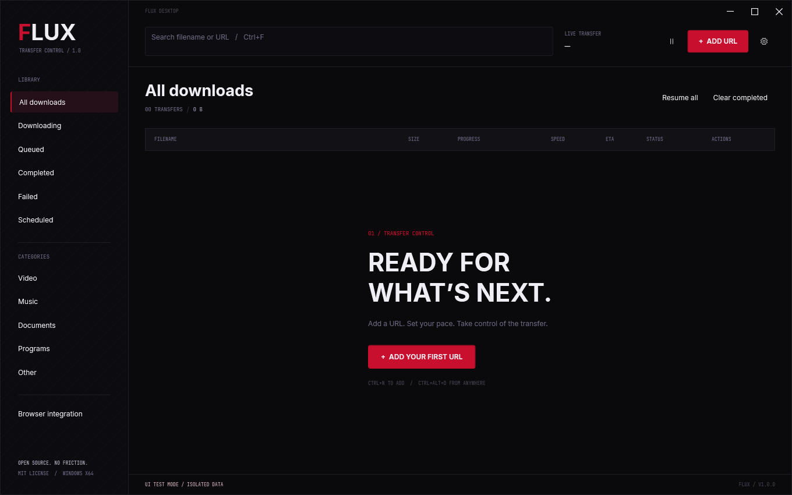

# Flux

**Downloads, under control.** Flux is an open-source Windows download manager with a native dark interface, adaptive parallel transfers, durable pause/resume, ordered queues, scheduling, and browser capture.

[Download v1.0.0](https://github.com/owaisraza40/flux/releases/tag/v1.0.0) · [User guide](docs/USER-GUIDE.md) · [Browser setup](docs/BROWSER-INTEGRATION.md) · [Validation](docs/VALIDATION.md)



Flux is independently implemented in C# and WPF. It provides familiar download-manager features, but does not claim identical IDM algorithms, identical performance, or compatibility with every site.

## Install

From [GitHub Releases](https://github.com/owaisraza40/flux/releases), download:

| Asset | Use |
| --- | --- |
| `Flux-Setup-1.0.0-win-x64.exe` | Recommended per-user NSIS installer |
| `Flux-1.0.0-win-x64-portable.zip` | Extract the complete archive and run `Flux.exe` |
| `Flux-Chromium-1.0.0.zip` | Unpacked Chrome/Edge extension for local use/testing |
| `Flux-Chromium-1.0.0.crx` | Signed CRX3 package; Chrome's off-store installation restrictions still apply |
| `Flux-Firefox-1.0.0.xpi` | Unsigned Firefox testing package; Mozilla signing is needed for persistent Release/Beta installation |
| `Flux-Browser-Extension-1.0.0.zip` | Both unpacked browser folders and their setup guide |
| `SHA256SUMS.txt` | Release-file checksums |

Flux targets **64-bit Windows 10/11**. The app includes its .NET runtime. Running it does not require the SDK, Node.js, Python, Java, Ghidra, or an IDM installation.

The installer defaults to `%LOCALAPPDATA%\Programs\Flux`, creates Start menu shortcuts, and offers an optional desktop shortcut. It runs for the current Windows user without administrator rights. Keep the browser-extension folders beside the executable when using the portable ZIP.

The application is not code-signed. Verify the release origin and checksum; Windows may report an unknown publisher. Do not disable Windows security features.

```powershell
Get-FileHash .\Flux-Setup-1.0.0-win-x64.exe -Algorithm SHA256
```

Compare the result with `SHA256SUMS.txt`.

## First download

1. Open Flux and choose **Add URL** or press **Ctrl+N**.
2. Paste a direct HTTP/HTTPS link, or one URL per line for a batch.
3. Choose a destination and filename. Optionally set category, priority, connections, speed cap, schedule, mirrors, or request metadata.
4. Start the download. The table shows size, progress, speed, ETA, status, and per-item actions.
5. Pause/resume from the row controls. Use **Pause all** to hold the queue.

Flux restores unfinished jobs after restart and offers to resume them. It uses durable checkpoint offsets; bytes not included in the last durable checkpoint can be downloaded again. Changed or unverifiable server content is restarted safely instead of being spliced into an old file.

See the [user guide](docs/USER-GUIDE.md) for all settings, recovery behavior, and troubleshooting.

## Features

### Transfer engine

- Segmented HTTP downloads with a default of eight and up to **32 simultaneous connections**, where file size and server support permit.
- **Dynamic allocation:** an idle worker can take part of a still-active slow region. The previous writer is stopped and joined before ownership changes.
- Persistent partial files, exact saved byte offsets, pause/resume, restart recovery, and a tested forced-process-death recovery path.
- Bounded exponential-backoff retries, configurable up to **10 retries**.
- Global and per-download bandwidth limits; zero means unlimited.
- Safe sequential fallback for unsupported ranges and unknown-length responses.
- Range coordinates, total length, byte counts, and entity validators checked before accepting content.
- Alternate mirrors, configurable User-Agent, referrer, cookies, and explicit HTTP headers.
- Filename collision policy: rename, explicitly overwrite after successful transfer, or skip.
- Automatic file-type categories and configurable category destinations.

More connections do not guarantee faster downloads. Server limits, the network, and storage still matter. Small files and servers without safe range/validator support may use fewer connections or one stream. Global bandwidth allocation is deliberately conservative across configured simultaneous jobs and external media processes, so unused capacity is possible when fewer jobs run.

### Queue and desktop

- Ordered queue, High/Normal/Low priorities, and drag-to-reorder.
- Per-job start/stop times and daily off-peak windows, including overnight windows.
- Searchable completed/failed history and status/category filters.
- Crimson-on-near-black interface with Inter and JetBrains Mono, table rows, thin progress bars, and compact context menus.
- Tray icon with open/add/pause/resume/exit actions.
- **Ctrl+Alt+D** global Add URL shortcut; **Ctrl+Q** explicit exit.
- Opt-in clipboard URL prompts and completion notifications.
- Release update checks that notify; no silent executable installation.

Scheduling requires Flux to remain running. It does not wake a sleeping PC or install a Windows service. Manually paused jobs remain paused.

### Browser and media

Chrome/Edge and Firefox packages can:

- Capture matching download links and browser-created downloads while Flux is connected.
- Send a right-click link or URLs from the popup.
- Pass the selected target URL's cookies, page referrer, user agent, and filename hint.
- Show a pre-filled confirmation dialog in Flux.
- Apply capture filetype rules and domain allow/block lists.
- Add video/audio download controls and identify HLS/DASH manifest hints.
- Display an app-connection heartbeat badge.

The extension pairs using native messaging, then connects through an authenticated loopback WebSocket at `ws://localhost:6543/`. A disconnected/refused handoff retains or resumes the ordinary browser download where possible.

HLS/DASH and supported video pages are handled through **yt-dlp and FFmpeg**. On first media use Flux downloads the separate upstream tools from GitHub and verifies their published SHA-256 digests before running them. They are not bundled in the installer. First-use preparation needs network access, disk space, and some time.

Media/site compatibility depends on the upstream extractor, source availability, login/session behavior, and format. DRM handling and access-control circumvention are not implemented. Media context supports domain-scoped cookies, referrer, and User-Agent; other custom headers belong to direct HTTP mode.

### Completion hooks

A download may request Defender or a configured scanner, then optionally open the result, play a sound, or run a user-selected local `.ps1`/`.exe` completion script. Open/script actions default to **None**. A scanner failure prevents subsequent configured actions. Browser messages cannot choose scripts, executables, or local completion actions.

## Browser extension setup

For Chrome/Edge:

1. Open `chrome://extensions` or `edge://extensions`.
2. Enable Developer mode, choose **Load unpacked**, and select `browser-extension/chromium`.
3. Register the extension ID in Flux → **Browser integration**.
4. Send a link to pair, then check the connection badge.

The included CRX is a real CRX3 build package, **not a Chrome Web Store publication**. Consumer Chrome on Windows/macOS restricts directly installing off-store CRX files. Unpacked loading is the documented local-use/testing path.

For Firefox, load `browser-extension/firefox/manifest.json` or its XPI using **Load Temporary Add-on** at `about:debugging#/runtime/this-firefox`, then register Firefox in Flux. Persistent Release/Beta installation requires AMO signing. The release XPI is unsigned; do not disable signature enforcement.

See the [complete browser guide](docs/BROWSER-INTEGRATION.md) for permissions, cookies, pairing, capture settings, store limitations, and rebuilding with your own extension identity.

## Data and privacy

Application state is in `%LOCALAPPDATA%\Flux`; default downloads go to `%USERPROFILE%\Downloads\Flux`.

State can contain full URLs, request headers/cookies, partial-download checkpoints, browser pairings, and installed media tools. Do not upload that directory or paste credentials into public issues. Clipboard monitoring is opt-in. Flux does not import your browser-history database or unrelated cookies.

Flux adds no advertising or analytics client. Network access is used for the requested URLs and their redirects, optional release checks, and first-use media-tool setup. Ordinary TLS certificate validation stays enabled. Credential headers are not automatically forwarded to unrelated redirect/mirror origins.

Uninstall removes program files and native-host registrations while retaining personal downloads and user state. See [Security](SECURITY.md), [third-party notices](THIRD-PARTY-NOTICES.md), and the user guide.

## Build from source

Prerequisites:

- Windows x64 and PowerShell 7.
- [.NET 10 SDK](https://dotnet.microsoft.com/download/dotnet/10.0); `global.json` selects 10.0.402 with patch roll-forward.
- Node.js 24+.
- [NSIS](https://nsis.sourceforge.io/Download) for the installer.

```powershell
git clone https://github.com/owaisraza40/flux.git
cd flux
pwsh -File scripts/build.ps1 -NsisCompiler 'C:\Program Files (x86)\NSIS\makensis.exe'
```

Use `-DotnetPath` to select another SDK executable or `-SkipInstaller` for portable-only output. `-SkipTests` is for local iteration; do not use it to qualify a release.

The build packages extensions, restores Microsoft's build/runtime packs, runs core/native/service/extension checks, publishes a self-contained EXE, checks actual EXE native messaging, then writes installer/ZIP/checksum files to `artifacts/release`.

For a real local HLS/media-tool integration check, allow the additional first-use upstream downloads:

```powershell
pwsh -File scripts/build.ps1 -MediaIntegration -NsisCompiler 'C:\Program Files (x86)\NSIS\makensis.exe'
```

### Run checks separately

```powershell
node browser-extension/scripts/package.mjs
node --test browser-extension/tests/*.test.mjs

dotnet restore tests/Flux.Tests/Flux.Tests.csproj --configfile NuGet.Config
dotnet run --project tests/Flux.Tests/Flux.Tests.csproj -c Release --no-restore

dotnet restore browser-extension/tests/NativeBridge.Tests/NativeBridge.Tests.csproj --configfile NuGet.Config
dotnet run --project browser-extension/tests/NativeBridge.Tests/NativeBridge.Tests.csproj -c Release --no-restore

dotnet restore tests/Flux.Services.Tests/Flux.Services.Tests.csproj --configfile NuGet.Config
dotnet run --project tests/Flux.Services.Tests/Flux.Services.Tests.csproj -c Release --no-restore
```

The native/WebSocket harness uses an isolated test pipe and ephemeral loopback port, so it can run alongside Flux. The HTTP suite uses generated data and loopback fixture servers; it does not need an Internet download service.

After publishing:

```powershell
node browser-extension/tests/native-host-smoke.mjs artifacts/publish/Flux.exe
node browser-extension/tests/desktop-e2e.mjs artifacts/publish/Flux.exe http://127.0.0.1:YOUR_FIXTURE_PORT/file.bin --keep-open
```

The latter runs the actual extension background source with controlled browser APIs and a real desktop WebSocket. It leaves a pre-filled dialog for inspection/confirmation; it is not a claim of live browser-store installation.

## Verification scope

The final local build passed **30 engine scenarios, 43 native/WebSocket checks, 20 extension/package checks, nine service/media checks, and five published-EXE checks**. This includes adaptive splitting with pause/restart, forced process death, credential boundaries, queue policies, browser metadata, wrong-token/origin rejection, a real HLS download, and package signatures. The installer was also installed, checked, and uninstalled with a user-file preservation canary.

The [validation report](docs/VALIDATION.md) is the source for final packaged-EXE, live HLS, visual, installer, and end-to-end results. A passing unit/integration suite is not a claim that every browser version, media site, proxy, hardware failure, or Windows PC has been tested. No exact IDM algorithm/performance equivalence is claimed.

## Project layout

```text
src/Flux.Core/                    HTTP engine, queue, scheduler, durable state
src/Flux.App/                     WPF interface and desktop lifecycle
src/Flux.App/Integration/         Native messaging and loopback WebSocket bridge
src/Flux.App/Services/            Media, completion hooks, update checks
tests/Flux.Tests/                Deterministic HTTP and recovery tests
tests/Flux.Services.Tests/       Service and optional real-media checks
browser-extension/              Chromium/Firefox source, packages, tests
installer/Flux.nsi               Per-user Windows installer
scripts/                        Build and release automation
docs/                           User, architecture, browser and release guides
```

## Contributing and license

Read [Contributing](CONTRIBUTING.md), [Architecture](docs/ARCHITECTURE.md), and [Releasing](docs/RELEASING.md). Report reproducible issues with a public/local URL and visible error, never private cookies or tokens.

Flux source and original artwork are [MIT licensed](LICENSE). Bundled fonts/runtime components retain their upstream notices. The source and releases contain no proprietary IDM executables, DLLs, extensions, icons, or decompiled source. Flux is not affiliated with IDM or Tonec.
